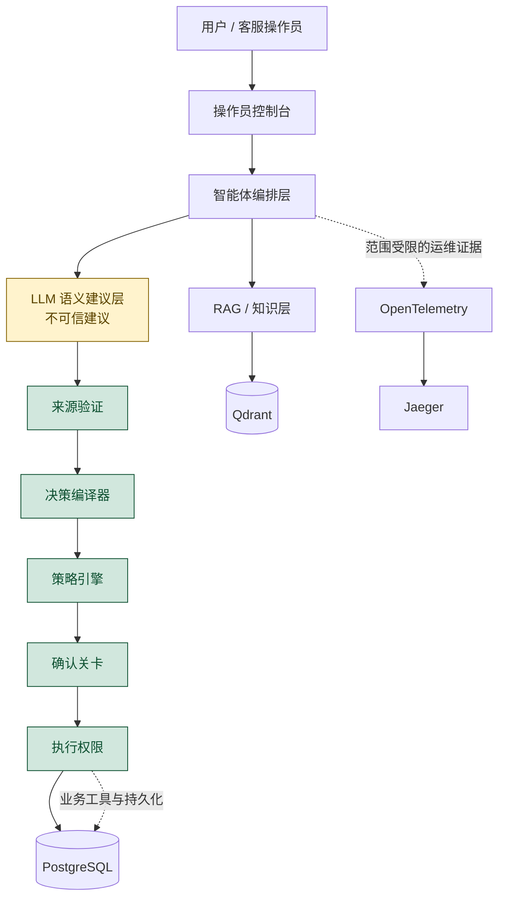
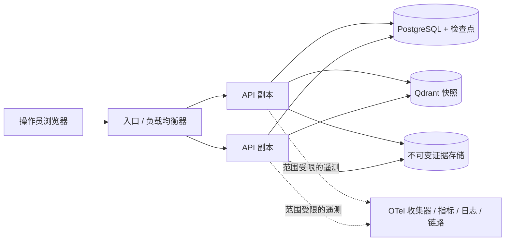

# 架构概览

> 原文：[docs/architecture.md](../architecture.md)。翻译基准：`d2523b0`。本文描述上游参考实现，不代表个人独立开发成果。

平台将语义建议与执行权限（execution authority）分离。LLM 产生不可信的建议；确定性的服务端层负责验证、授权、持久化和执行业务效果。

> **LLM 不掌握执行权限。**

信任边界：

- LLM 输出只能作为建议，不能确立客户范围、可信标识符、策略结果或确认状态。
- 来源验证、决策编译器和策略引擎构成确定性的验证与授权边界。
- 确认关卡将批准绑定到已经持久化的动作状态；执行权限层负责最终的业务状态修改及其幂等边界。
- Qdrant/RAG、记忆和可观测性提供上下文或诊断证据，均不能独立赋予执行权限。

## 为什么 LLM 不掌握执行权限

平台区分四种可观察的职责：

- **上下文（Context）：** 只提供信息。记忆和 RAG 丰富理解，但不能授权动作。
- **建议（Proposal）：** 模型产生语义建议，输出始终不可信。
- **决策（Decision）：** 确定性层验证来源、策略、风险和可接受性。
- **权限（Authority）：** 只有受控的运行时路径才能修改状态。

操作员控制台展示这些边界，但不暴露思维链或模型隐藏推理。范围限定在已有证据内的简短演示见[演示场景（英文）](../demo-scenarios.md)。

## 运行时契约

默认可运行路径使用 `semantic_decision_v3`：模型输出范围受限的语义建议，服务端掌握的依据校验、可接受性检查、编译器、类型验证、策略、确认和执行层保留权限。`direct_tool_v1` 仅作为显式选择的兼容契约保留，用于历史评测或旧系统集成。

## 部署拓扑

可执行的参考技术栈将面向操作员的前端与 API 及其共享状态服务分开。生产部署会在多个 API 副本前设置入口或负载均衡器：

PostgreSQL 仍是业务状态、幂等、租户范围内审计及持久化视图投影的共享数据来源。记忆、RAG 和证据存储用于辅助或记录决策，绝不授予执行权限。仓库提供的是面向生产工程的参考拓扑，不是托管的生产服务：入口、TLS、身份与会话集成、故障切换、备份、对象存储保留策略和多区域编排仍由实际部署方负责。
