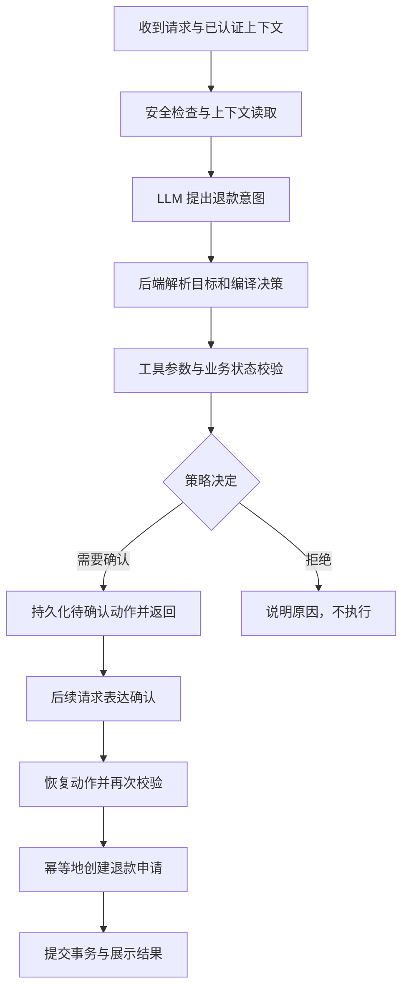

# 小白学习路线：先会讲一条调用链，再逐步扩大范围

本路线针对当前仓库基准 `d2523b0`。这是配套学习材料，不是上游文档译文。目标是准备 Agent 应用开发实习面试，不要求重写整个系统。

## 先明确完成标准

你应当能在不看笔记的情况下：

1. 用 90 秒说明项目用途、上游来源和自己的工作。
2. 画出退款申请和知识问答两条主线，解释每个模块的输入、输出及职责。
3. 指出三个关键代码位置，解释为什么需要确认、再次校验和幂等。
4. 区分演示回放、真实模型调用、测试替身，以及本地验证与上游报告。
5. 如实回答“你写了哪些代码”，不把原仓库的功能和指标当成自己的成果。

不用逐行背源码，也不用一次学完多租户、OIDC、指标管道和所有实验报告。

## 时间安排

下列时间是建议学习投入，因基础而异。可以边投递边学习；按验收问题决定是否进入下一步，不靠背题数量判断学会没有。

| 阶段 | 建议投入 | 产出 |
| --- | --- | --- |
| 紧急准备 | 2～3 小时 | 项目介绍、一张主线图、贡献边界 |
| 核心理解 | 4～6 小时 | 退款申请调用链、确认与幂等解释 |
| RAG 与验证 | 3～4 小时 | 问答调用链、测试分层、演示记录 |
| 面试练习 | 1～2 小时 | 90 秒介绍、六个追问、两次模拟讲解 |

若只能投入半天，先完成紧急准备与退款申请主线。简历中暂不写还没学懂的设计分析。

## 第 0 步：建立项目地图（30～45 分钟）

读 [中文总览](project-overview.md) 和 [中文架构](architecture.md)。先理解以下关系：

| 组件 | 白话职责 | 不是它的职责 |
| --- | --- | --- |
| React 前端 | 发请求、展示消息和系统证据 | 批准退款或授予权限 |
| FastAPI | 接收请求、取得已认证的执行上下文 | 把前端传来的客户 ID 自动当成授权 |
| LangGraph | 按状态和条件组织工作流 | 自动保证业务权限正确 |
| LLM | 理解自然语言，提出结构化语义建议 | 决定自己能操作谁的数据 |
| 策略与工具层 | 确定性校验、确认和受控业务写入 | 仅凭模型说“允许”就执行 |
| PostgreSQL | 业务记录、检查点、待确认动作和审计等持久化 | 向量语义检索 |
| Qdrant / RAG | 检索知识，支持有依据的回答 | 用知识文本授予业务执行权限 |
| OpenTelemetry / Jaeger | 收集和查看追踪证据 | 替代业务事务或权限控制 |

**验收：**解释为什么“Agent 客服”比“检索一段文字然后回答”多出业务执行问题。

## 第 1 步：认识入口与状态（45～60 分钟）

按顺序只读这些文件的函数入口、类型和调用关系：

1. [前端 API 客户端](../../frontend/src/api/client.ts)：谁发送请求，怎样取得响应。
2. [聊天 API](../../app/api/routes/agent.py)：`chat()` 如何取得执行上下文和数据库会话。
3. [Agent 运行时](../../app/agent/runtime.py)：`AgentRuntime.run()` 如何准备和运行工作流。
4. [状态定义](../../app/agent/state.py)：工作流不同节点共享哪些字段。
5. [图编排](../../app/agent/graph.py)：看 `build_graph()` 的节点和边，先跳过追踪包装代码。

每个模块只记四项：输入、输出、调用谁、失败如何结束。不要把大文件从第一行读到最后一行。

**验收：**回答“浏览器发出请求后，模型在哪一步被调用？业务写入在哪一步发生？它们为什么分开？”

## 第 2 步：走通退款申请（90～120 分钟）

这是业务主线的概念图，省略记忆、审计和中断恢复支路；不是对 `graph.py` 每条边的一比一复刻。



对照源码阅读：

| 问题 | 代码位置 |
| --- | --- |
| 模型理解用户想做什么 | [understand_request.py](../../app/agent/nodes/understand_request.py) |
| 语义建议如何进入确定性决策 | [compile_decision.py](../../app/agent/nodes/compile_decision.py) |
| 参数和业务状态如何检查 | [validate_tool.py](../../app/agent/nodes/validate_tool.py) |
| 策略如何决定允许、拒绝或确认 | [engine.py](../../app/policies/engine.py) |
| 待确认动作如何保存 | [create_pending.py](../../app/agent/nodes/create_pending.py) |
| 后续确认如何识别 | [check_pending.py](../../app/agent/nodes/check_pending.py) |
| 确认后如何再次校验 | [revalidate.py](../../app/agent/nodes/revalidate.py) |
| 工具调用与错误如何处理 | [execute_tool.py](../../app/agent/nodes/execute_tool.py) |
| 退款申请最终写在哪里 | [refunds.py](../../app/tools/refunds.py) |

注意：`request_refund` 创建的是数据库中的退款申请，不能说它已经接入支付渠道并完成返款。

**练习：**用自己的话讲“用户先申请退款，过了几分钟才确认，但订单状态已经变了”，系统为什么不能直接执行之前的动作。

## 第 3 步：搞懂幂等与持久化（60～90 分钟）

阅读 [idempotency.py](../../app/services/idempotency.py)。核心不是“把一个 ID 放进缓存”，而是：

1. 通过租户、操作者、操作类型和幂等键识别一次业务操作。
2. 对请求内容生成指纹，避免同一个键被用于不同请求。
3. 将业务写入和执行回执置于同一事务边界内。
4. 已有回执时校验内容并加载原结果；并发冲突需要数据库约束兜底。
5. 提交连接丢失或超时时，结果可能未知，不能盲目重试写操作。

再区分三种状态：

- 检查点：工作流处理到哪里，下一轮怎样恢复。
- 待确认动作：用户究竟在确认哪个动作，参数是什么，是否过期。
- 业务记录与回执：数据库里实际发生了什么，重复操作怎样处理。

**验收：**分别回答“刷新浏览器”“重复点击确认”“提交时网络断开”为什么是三个不同问题。

## 第 4 步：走通知识问答（60～90 分钟）

从 [retrieve_knowledge.py](../../app/agent/nodes/retrieve_knowledge.py) 顺着调用阅读检索层，而不是先背 RAG 名词。

```text
知识文件 → 切分 → 向量生成与索引
用户问题 → 稠密/词法检索 → 合并与重排 → 依据校验 → 回答或拒答
```

对应目录：

- [知识文件](../../app/knowledge/)：原始政策与 FAQ。
- [切分](../../app/rag/ingestion/chunking.py)：怎样形成检索片段。
- [混合检索](../../app/rag/retrieval/hybrid.py)：不同检索结果如何结合。
- [确定性 embedding](../../app/rag/embeddings/deterministic.py)：演示与测试用向量生成。
- [回答生成与依据校验](../../app/rag/answer_generator.py)：引用和证据边界。

当前本地配置使用 `EMBEDDING_PROVIDER=deterministic`，不能由此声称真实语义检索准确率很高。中文界面也不代表中文知识检索或中文模型理解已经验证。

**验收：**为什么“政策文档说可以退款”仍不能替代订单归属、状态和确认校验？

## 第 5 步：用测试和演示巩固（60～90 分钟）

阅读 [演示文档](demo-walkthrough.md)，使用独立会话记录以下场景。涉及演示种子数据时，以当前数据库状态为准；不要把已有退款再次提交当成正常首轮。

| 场景 | 观察重点 | 记录什么 |
| --- | --- | --- |
| 退款申请 | 确认前是否写入，确认后是否再次校验 | 会话 ID、动作状态、结果 |
| 无效订单状态或越权目标 | 是否停止执行 | 验证理由、订单是否变化 |
| 重复确认 | 同一动作是否产生重复业务记录 | 同一动作的执行回执与结果 |
| 政策问答 | 有没有检索依据，证据不足如何处理 | 检索来源、依据校验状态 |

先标明执行模式：静态演示、记录回放、实际模型请求。演示卡片显示通过，不等于真实模型刚完成了该操作。

已有环境中运行核心测试（PowerShell，项目根目录）：

```powershell
.\.venv\Scripts\python.exe -m pytest tests/test_agent.py tests/test_rag.py tests/test_tools.py
```

运行测试不会要求你重建 `uv.lock`。仓库固定 `uv 0.11.16`，保持已有环境和锁文件。

读 [tests/conftest.py](../../tests/conftest.py) 和 [Fake 提供者](../../app/agent/llm/fake.py)：理解 SQLite、内存检查点和模型替身的用途。核心测试通过证明受控输入下的业务逻辑，不是模型准确率、真实并发可靠性或生产可用性的证明。

追踪配置也要看启动方式：本地 `.env` 的 `OTEL_ENABLED=false` 不等于 Docker 后端关闭追踪；`docker-compose.yml` 对 backend 明确覆盖为 `true`。是否真的有 Trace，需在 Jaeger 中验证。

## 第 6 步：整理面试表达（60 分钟）

先看 [简历与贡献边界](resume.md)，再看 [面试问答](interview.md)。录音或向同学讲解两遍：

1. 90 秒项目介绍。
2. 3 分钟退款申请主线。
3. 2 分钟解释幂等与确认后再次校验。

不要背“我设计了”的回答。如果没有亲自设计，回答“原项目采用这个方案，我理解其原因是……；我完成的改动是中文化与学习材料整理”。

## 暂时跳过的内容

初次准备可跳过所有历史模型兼容性实验、完整 OIDC 接入、多副本部署、Prometheus 管道、灾备和全部对抗实验。被问到时说明原仓库有相关实现或方案，但你尚未深入验证；不要用名词堆砌冒充经验。

## 自测清单

- [ ] 我能说明开源来源与自己的改动。
- [ ] 我能在代码里找到 API、运行时、图、策略、工具和幂等层。
- [ ] 我知道模型输出不是权限。
- [ ] 我能解释为什么确认后仍要再次校验。
- [ ] 我能解释重复请求、并发冲突和写入结果未知。
- [ ] 我知道当前退款工具没有接支付渠道。
- [ ] 我能区分 RAG 证据与业务授权。
- [ ] 我能区分演示、回放、真实模型调用和测试替身。
- [ ] 我只在简历中写已完成且能展示的工作。
