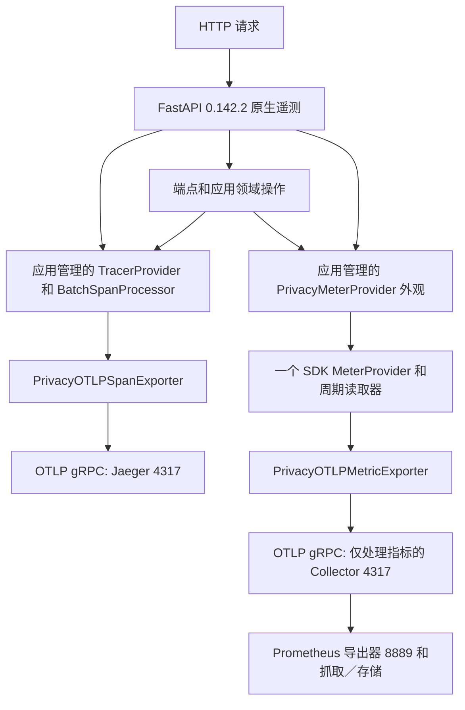

# 可观测性架构与验收

> 中文译文｜[英文原文](../observability.md)｜基准提交：`d2523b0`。以下验收与证据属于上游项目，不代表个人完成的验证或生产落地成果。

本仓库是作品集／参考项目。以下检查属于可复现的本地和 CI 验收；它们不能证明已有线上生产部署、公共入口、外部 OIDC、生产容量或部署 TLS 策略。

## 信号的管理职责

`app/main.py` 和 `ObservabilityLifecycle` 负责启动初始化／关闭。原生 FastAPI 接收的正是应用管理的提供者对象，不会自动配置它们。`auto_configure=False`、`logs=False`，操作 span 遵循主追踪开关。领域指标和原生指标都不会注册或采用全局 meter provider。两类指标共用一个提供者、读取器和导出器。

框架遥测覆盖请求／服务端、依赖、端点、序列化和后台任务操作。应用 span（`agent.run`、策略、工具、RAG、记忆和可靠性）仍由各领域调用点管理，并继承当前 OTel 上下文。原生操作 span 可能位于 SERVER span 和领域 span 之间。

## 启用方式

| 主开关 `OTEL_ENABLED` | `OTEL_METRICS_ENABLED` | 追踪 | 领域／原生 OTel 指标 |
|---|---|---|---|
| false | false/true | 不建立应用管理的管线 | 不建立应用管理的管线 |
| true | false | 启用 | 空操作（no-op） |
| true | true | 启用 | 通过同一个应用管理的外观启用 |

应用配置默认关闭遥测。本地 Compose 明确启用向 `http://jaeger:4317` 发送追踪；指标默认关闭。启动可选的 `metrics` profile，并明确设置 `OTEL_METRICS_ENABLED=true`，才能向已预配置的 Collector 端点导出指标。仅激活 profile 和设置 OTLP 环境变量不会启用应用指标。

在初始化成功前、禁用／失败状态下，以及应用管理的组件关闭之后，应用 OTel 指标都是空操作。进程内运行摘要和业务／UI 投影继续独立工作。禁用状态下的投影不一定包含 trace ID。已激活的提供者不能在原进程内重新配置；最终关闭之后必须启动新进程。

## 隐私与基数

T1 隐私契约仍具有最终效力。追踪隐私在最终 protobuf 投影中强制执行；指标标签在记录前，以及最终 protobuf 投影中再次受到约束。原始提示词／消息／请求体、输出、参数、检索／记忆内容、身份标识符、原始 URL／查询字符串、认证信息／cookie、凭据、原始异常和任意资源／scope 元数据，都不允许成为导出渠道。符合规范的允许使用的请求／运行 UUID 可以关联追踪，但绝不作为指标标签。路由使用注册的模板，未匹配路径不会成为路由维度，分类指标使用有限目录。Exemplar（样本关联数据）被禁用。

原始 Uvicorn 访问记录被抑制。安全 HTTP 日志保留范围有限的方法、注册路由模板或 `unmatched`、数值状态码和持续时间。Uvicorn 异常记录不包含原始异常／堆栈／原因数据。原生 OTel 日志保持关闭；本应用过滤器并不能普遍净化任意第三方日志。

Collector 在向 Prometheus 暴露数据前删除资源属性，排除资源／scope 元数据，并且只有指标管线。Prometheus 添加固定的静态 `job`／`instance` 抓取元数据。Collector 端口不对外公开；Prometheus UI 绑定 localhost。本地默认保留限制是 7 天／1 GiB。这里不声称本地 Docker 网络具有认证／TLS。

此指标拓扑仅验收了**一个产生指标的后端进程**。当累积时间序列缺少生产者维度时，多 worker／副本可能产生冲突；本次验收不支持其指标聚合。未经单独审查设计，不要增加身份标签或扩展生产者数量。

## 实测证据

- [T3 原生追踪](../fastapi-native-otel-t3-native-tracing.md)：框架／领域操作，以及提供者／上下文契约。
- [T4D 传递](../fastapi-native-otel-t4d-metrics-delivery.md)：真实的已认证领域／原生指标传递、实际转换后的 Prometheus 名称、计数器／直方图增量、隐私和 Collector 恢复。PR #10 通过了远端 amd64 CI。
- [T5 运行时／发布记录](../fastapi-native-otel-t5-runtime-release-evidence.md)：SIGTERM、处理中请求的排空、禁用模式和端点失败证据，以及本地 TLS／认证传输检查。

RPC／导出成功、SDK force-flush 和后端持久存储是不同层面的结论。接收方不可用时可能丢失测量数据；本项目不保证持久化重放。指标／追踪失败属于观测失败，不得改变业务正确性或健康／就绪语义。关闭耗时样本是场景证据，不是针对任意负载或后端故障的 SLO。

## 回滚

通过启动**新进程**进行配置回滚，不要在同一进程内修改或重新启动已关闭的提供者。

1. **只禁用指标：**设置 `OTEL_METRICS_ENABLED=false`，保留 `OTEL_ENABLED=true`，并重新创建后端。原生／领域指标导出停止；追踪、投影和进程内摘要保持运行。不再需要时，可以独立停止 metrics profile。
2. **禁用全部应用 OTel：**设置 `OTEL_ENABLED=false`，并重新创建后端。主开关优先于指标开关和 OTLP 环境变量。业务行为、投影和运行摘要保持不变；无法建立新的追踪关联。
3. **版本回滚：**使用已知且经过验证的源代码／镜像版本，同时使用与它匹配的锁文件和配置。不要在保留原生追踪时单独恢复 contrib instrumentation。回滚至原生迁移之前，需要一起恢复此前的代码和依赖集合。
4. 回滚后验证健康／就绪状态和一个已认证的只读请求。检查投影／摘要行为，以及预期的信号启用状态。保留 PostgreSQL／Qdrant 数据；不要针对真实应用项目使用一次性验收运行器，也不要将 `down --volumes` 当作回滚流程。

源代码回滚不等于数据库回滚。要独立审查迁移、持久化状态兼容性和检查点；绝不重放未确认的业务写入，也不绕过授权／确认。未来真正部署时，需要单独验证入口、秘密管理、TLS／认证、容量、备份，以及发布切换／请求排空。
